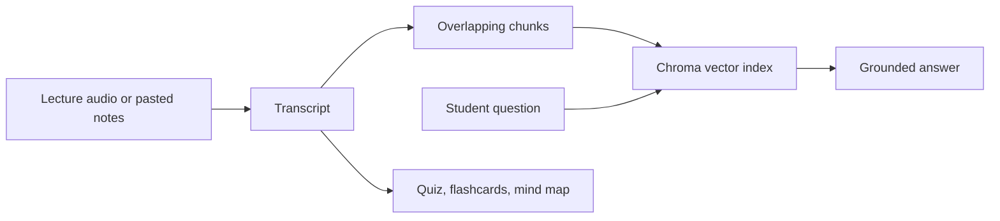

# Sonar Mind: The Educational Assistant

Sonar Mind turns a lecture into something a student can search, question, and revise. Upload a recording or paste a transcript, then ask questions that stay grounded in that lecture, take a short quiz, review flashcards, or open a mind map.

This is the B.Tech capstone **Sonar Mind** from VIT-AP University, School of Computer Science Engineering, Computer Science and Business Systems (August 2025). The original report was a single notebook. This repository is that project rebuilt so it runs on current Gemini models and can be shown in a portfolio.

**Team**

| Role | Name | Register no. |
| --- | --- | --- |
| Team lead | Patan Mohammed Ibrahim Khan | 22BCB7267 |
| Member | Duggireddy Venu | 22BCB7275 |
| Member | Maile Hruday Raj | 22BCB7132 |
| Member | Sanikommu Divakar Reddy | 22BCB7003 |

Guide: Dr. Hussain Syed

## What a reviewer can try

1. Open `Sonar_Mind.ipynb` for the walkthrough.
2. Or run the app locally (steps below) and paste `sample_data/sample_lecture.txt`.
3. Index the transcript, then ask “What is a foreign key?”, generate a quiz, flip a flashcard, and build a mind map.

Live study features call the Gemini API, so they need `GOOGLE_API_KEY`. The notebook’s offline checks (chunking, quiz scoring, mind-map layout) do not.

## How it works

1. **Audio or pasted text.** Gemini transcribes an uploaded lecture. A pasted transcript is there for demos and for students who already have notes.
2. **Chunking.** LangChain’s recursive splitter cuts the transcript into overlapping passages.
3. **Embeddings.** Each passage is embedded and stored in Chroma.
4. **Grounded answers.** A question retrieves the closest passages. Gemini answers from those passages only and says when the lecture does not cover it.
5. **Quiz, flashcards, and mind map.** The same transcript is turned into JSON the interface can render. Quiz scoring and streaks run in the app, not in the model.



## Run it locally

```bash
python -m venv .venv
.venv\Scripts\activate
pip install -r requirements.txt
copy .env.example .env
```

Put a Gemini API key in `.env` as `GOOGLE_API_KEY`. Create one in Google AI Studio. Do not commit `.env`.

```bash
python app.py
```

Open the local URL Gradio prints. To use the notebook:

```bash
pip install notebook
jupyter notebook Sonar_Mind.ipynb
```

Offline tests, from the project folder:

```bash
python tests/test_offline.py
```

## Deploy on Hugging Face Spaces

The capstone report expects the key to live as a Hugging Face secret, not in the notebook.

1. Create a **Gradio** Space.
2. Push this repository, or upload these files. `app.py` is the Space entry file.
3. In the Space, open **Settings → Secrets** and add `GOOGLE_API_KEY`.
4. Optional secrets: `GEMINI_MODEL` and `GEMINI_EMBED_MODEL`.
5. Wait until the Space is **Running**, then open the app and paste the sample lecture before indexing.

The app refuses to call Gemini until that secret exists. The key is read from the environment at request time.

## Stack

- Gemini for speech-to-text, grounded answers, and structured study JSON
- LangChain for splitting, retrieval, and prompt templates
- Chroma for the vector index
- Gradio for the interface

## What changed from the August 2025 report

The report pinned `gradio==4.14.0`, `google-generativeai==0.3.2`, and `fastapi==0.112.2`, and it called `gemini-2.0-flash` plus `text-embedding-004`. Those models are retired on the Gemini API, and those package pins conflict with current libraries. This repo uses current Gemini chat and embedding models (override them with environment variables) and library versions that install together.

The report’s retrieval function also stopped before the chain was returned, and the indexing error string was missing a closing quote. Both are fixed here. Mind-map text is escaped before it is placed in HTML.

## Limits

Transcription quality drops with noise or overlapping speakers. Quizzes and answers use only the transcript, so they miss anything the speaker did not say. The interface is one shared session: clearing the transcript also clears the index so a new lecture does not answer from the previous one.
